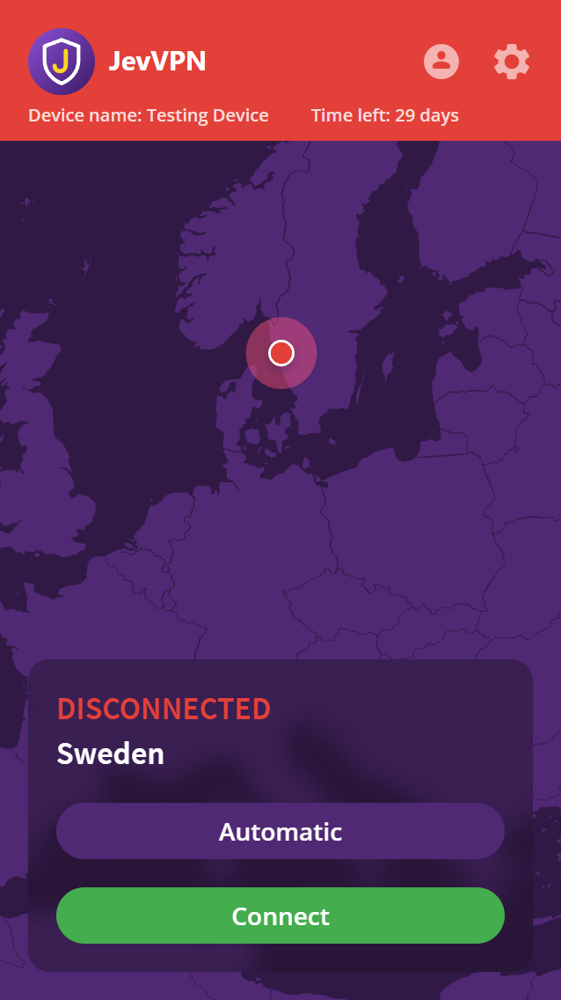
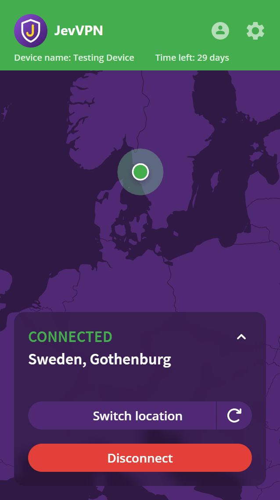
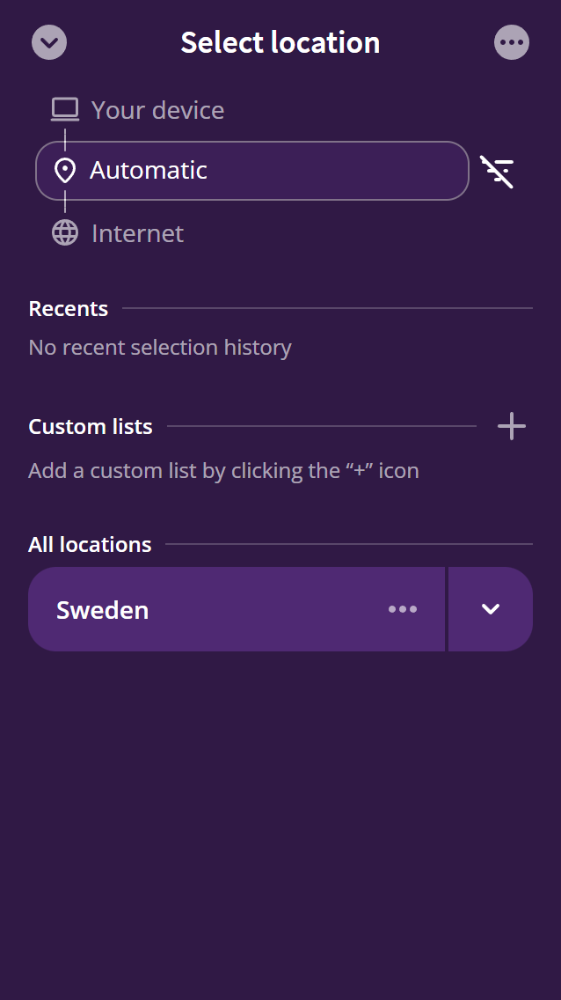
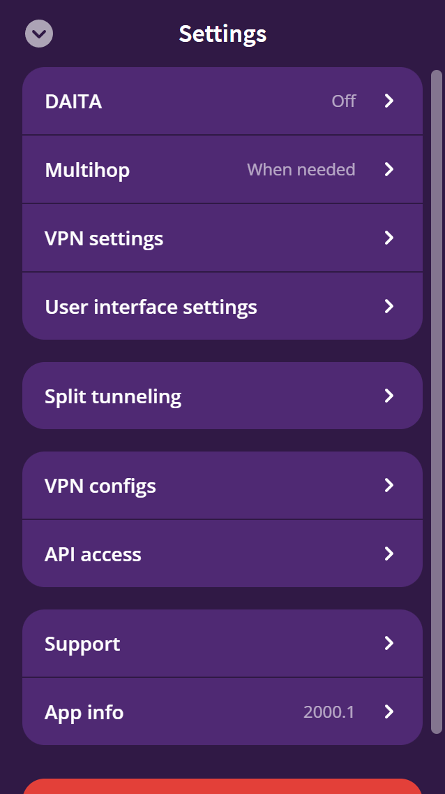
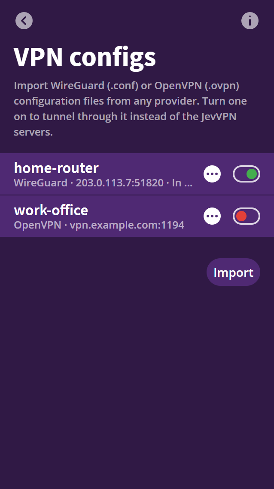
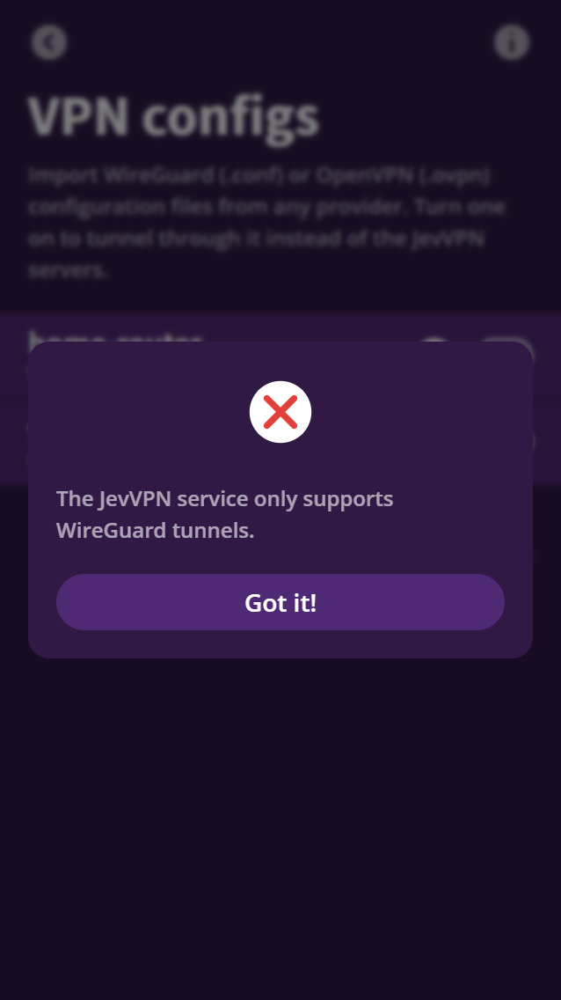

<p align="center"></p>

JevVPN is a rebranded fork of the [Mullvad VPN](https://github.com/mullvad/mullvadvpn-app) desktop
app for Windows and Linux. It keeps Mullvad's Rust background service and Electron GUI, changes the
name, logo and color scheme (purple), and adds import of your own WireGuard and OpenVPN config files.

## Screenshots

<p align="center">
  
  
  
</p>
<p align="center">
  
  
  
</p>

Screenshots are taken from the GUI running against a mocked service.

## Features

- Tray icon with connect, disconnect and quit.
- 3D map that zooms to your approximate location, based on a GeoIP lookup.
- Import of WireGuard (`.conf`) and OpenVPN (`.ovpn`) config files under Settings > VPN configs.
- Kill switch and lockdown mode (block traffic when the tunnel is down).
- Split tunneling.
- DAITA, multihop and the rest of the Mullvad feature set, inherited from upstream.

## How it works

```
Electron GUI  <-- gRPC -->  JevVPN service (mullvad-daemon)  -->  WireGuard tunnel + firewall
              Windows: //./pipe/JevVPN
              Linux:   /var/run/jevvpn
```

- The GUI (`desktop/packages/mullvad-vpn`) talks to the background service over gRPC on a named
  pipe (Windows) or Unix socket (Linux).
- The service is Mullvad's Rust daemon (`mullvad-daemon.exe`), installed as the system service
  "JevVPN". It manages WireGuard tunnels and the firewall-based kill switch. On Windows it uses its
  own WFP filter GUIDs, and its data lives in `JevVPN` / `jevvpn` directories, so it does not share
  state with an official Mullvad install.
- Imported WireGuard configs are passed to the daemon through its custom VPN config RPC
  (`ImportCustomVpnConfig`).
- Imported configs are stored by the GUI and encrypted at rest with Electron `safeStorage`.
- Accounts, the relay list and Mullvad servers still use Mullvad's infrastructure. To connect to
  Mullvad servers you need a Mullvad account.

Code for the config import, relative to `desktop/packages/mullvad-vpn`:

| Part | Path |
|---|---|
| Parser | `src/shared/custom-vpn-config.ts` |
| Encrypted store | `src/main/custom-vpn-configs.ts` |
| IPC | `customVpnConfigs` in `src/shared/ipc-schema.ts` |
| UI | `src/renderer/components/views/custom-vpn-configs/` |

## Setup

### Install on Windows

Download the installer from the [Releases](https://github.com/Kjev0/JevVPN/releases) page, or build it yourself (below).

- The installer is not code-signed, so Windows SmartScreen shows a warning. Choose
  "More info" > "Run anyway" if you trust the build.
- The installer refuses to run while the official Mullvad VPN app is installed. Both apps use the
  same Mullvad-signed split-tunneling kernel driver, and two services sharing one driver would
  conflict. Uninstall Mullvad VPN first.

### Build from source on Windows

Requirements:

- Rust 1.100 via [rustup](https://rustup.rs) (pinned in `rust-toolchain.toml`), plus the 32-bit
  target for the installer plugin: `rustup target add i686-pc-windows-msvc`.
- Visual Studio Build Tools 2022 with the "Desktop development with C++" workload.
- Node.js and npm at the versions in the `volta` section of `desktop/package.json`
  (currently Node 24.21.0, npm 12.2.0).
- `protoc` on `PATH`, or the `PROTOC` environment variable pointing to `protoc.exe`.
- Git Bash (the build script and npm scripts call `bash`).

Build:

```sh
bash build.sh --optimize
```

The installer is written to `dist/JevVPN-<version>_x64.exe`. Leave out `--optimize` for a faster,
less optimized build. See [BuildInstructions.md](BuildInstructions.md) for the full upstream
toolchain notes.

### Linux

Download the `.deb` (Debian/Ubuntu) or `.rpm` (Fedora) package from the
[Releases](https://github.com/Kjev0/JevVPN/releases) page and install it:

```bash
sudo apt install ./JevVPN-<version>_amd64.deb      # Debian/Ubuntu
sudo dnf install ./JevVPN-<version>_x86_64.rpm     # Fedora
```

To build the packages yourself, run the **Linux packages** workflow in GitHub Actions (it builds on
Ubuntu and uploads to a release), or build on Linux or in WSL2. Step-by-step instructions are
in [docs/LINUX-BUILD.md](docs/LINUX-BUILD.md). The JevVPN packages cannot be installed alongside
the official Mullvad VPN Linux package, because the binaries under `/usr/bin` have the same names.

### Development mode

```sh
cd desktop
npm install
cd packages/mullvad-vpn
npm run develop   # Vite + Electron with hot reload, needs a running JevVPN service
```

### Mocked UI tests

The e2e setup replaces the main process with mocks (`test/e2e/setup/main.ts`), so the UI runs
without a service:

```sh
cd desktop/packages/mullvad-vpn
npm run e2e
```

Other checks: `npm run test` (unit tests), `npm run lint`, `npm run type-check`.

## Limitations

- OpenVPN configs can be imported and listed, but cannot connect. The upstream daemon removed
  OpenVPN support, so activating one shows an error.
- Builds are not code-signed.
- The background service still asks Mullvad's version API for the latest release. JevVPN ignores the answer and in-app upgrades are turned off.
- The Linux packages are built in CI but have not yet been tested on a real Linux machine.
- At the time of writing, the Windows installer has not been run on real hardware.

## Upstream

JevVPN is based on [mullvad/mullvadvpn-app](https://github.com/mullvad/mullvadvpn-app). Mullvad's
original README is in the git history of this repository.

## Credits

JevVPN is built on Mullvad VPN by [Mullvad VPN AB](https://mullvad.net). All of the core VPN and
daemon work is theirs. JevVPN is not affiliated with or endorsed by Mullvad VPN AB. "Mullvad" is a
trademark of Mullvad VPN AB. The Mullvad logo and mascot are not used; JevVPN uses its own artwork
(`desktop/packages/mullvad-vpn/assets/images/logo-icon.svg`). Remaining occurrences of "Mullvad"
in the code are internal identifiers, package names or attribution.

## License

GPL-3.0-or-later, the same as upstream. See [LICENSE.md](LICENSE.md). Upstream copyright notices
are kept, and modified files are distributed under the same license as required by the GPL.
